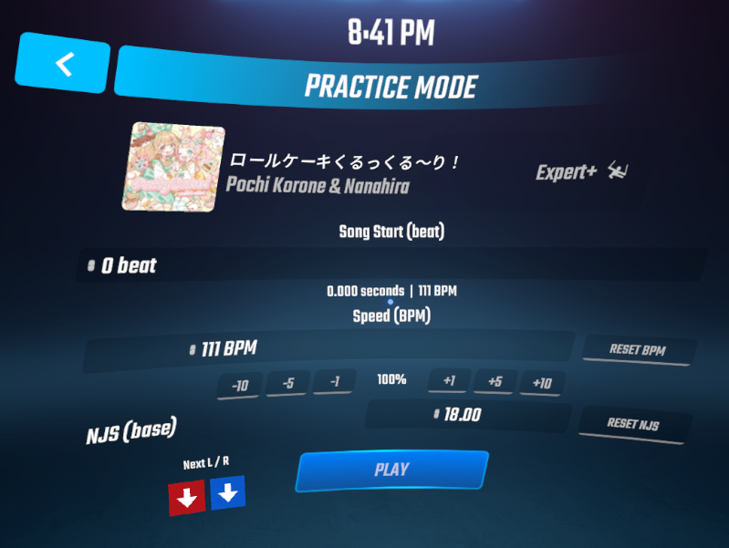

# AdvancedPractice

[한국어](README-ko.md)

Advanced practice plugin for Beat Saber.

It source-includes [LegatoBS 0.1.1](https://github.com/ScoreSaber/legato) for compatibility across game versions.

Derived from [denpadokei/PracticePlugin](https://github.com/denpadokei/PracticePlugin), but this is not fork of PracticePlugin.



## Features

- **Song Start:** Choose a zero-based beat in increments of 1, as in mapping tools. The display shows the corresponding start time in seconds to three decimal places and the BPM at that position, accounting for BPM changes. Changing the start beat previews that part of the song using the original Practice Mode preview function. Updates are debounced by 0.15 seconds while dragging, and selections made during audio loading play once the clip is ready.
- **First notes:** `Next L / R`, to the left of Play, shows each hand's next note independently, even when they occur at different times. A slot displays `None` when that hand has no notes remaining. Bombs and chain links are excluded; any-direction notes use a dot. Hints use default red/blue colors and the map's original directions, without custom colors, left-handed mode, or gameplay mirror transformations.
- **Speed:** Set a target BPM relative to the map BPM at the selected start position. The slider and `-10`, `-5`, `-1`, `+1`, `+5`, `+10` buttons update the target BPM and speed percentage. Supported speed is 10–500%. Changing the start beat preserves the target BPM, recalculates the percentage, and clamps it to the supported range. During playback, the selected multiplier stays fixed across subsequent BPM changes.
- **NJS:** Adjust base NJS from 1 to 50. Change the step in Mod Settings → AdvancedPractice; it takes effect the next time you open the practice screen. The default step is 1.
- **VNJS (1.40.8 / 1.44.1):** Displays the original map's NJS at the selected position using standard NJS events and easing. Adjusting base NJS preserves the map's relative VNJS events. Custom Noodle Extensions track animations are outside this display's scope.
- **JD:** Jump distance and spawn offset are left to JDFixer or BSPlus.

A newly selected chart starts at its original starting BPM and 100% speed, without inheriting another song's multiplier. Beat, target BPM, and NJS are remembered per song, characteristic, and difficulty for the current game session. Returning from practice restores the last selection; restarting the game clears it.

## Version support

This plugin is built on [ScoreSaber/legato](https://github.com/ScoreSaber/legato), which is version-compatiblity layer for beat saber plugins.

| Game version  | Legato profile |
| ------------- | -------------- |
| 1.42.0-1.44.1 | 1.42.0         |
| 1.40.0-1.40.8 | 1.40.0         |

## Installation

1. Install BSIPA and BeatSaberMarkupLanguage versions compatible with your game. Beat Saber 1.44.1 requires BSIPA 4.3.7+ and BSML 1.14.1+.
2. **Remove PracticePlugin.** If both plugins are loaded, AdvancedPractice logs an error and does not activate its features.
3. Copy the `Plugins` folder from the matching `artifacts/AdvancedPractice-0.3.0-bs<version>.zip` into the game folder. The installation ZIP contains only `Plugins/AdvancedPractice.dll` and its matching portable PDB. Direct build outputs are located at `bin/Release/<version>/`.
4. Restart the game and enter Practice Mode from song selection.

This plugin implements the **practice setup screen before a song starts**. PracticePlugin's pause-menu seeking/looping, failure-time display, and energy adjustments are not included. Build scripts do not deploy into the game automatically.

## Building and verification

Use the .NET 10 SDK, .NET Framework 4.8 reference assemblies, and PowerShell 7. Each target needs matching game references with BSIPA installed. Provide the corresponding BSML DLL in the game's `Plugins` folder or a separate mod reference folder.

```powershell
# Default target: 1.44.1. Builds, checks API contracts and the manifest, and creates a ZIP.
pwsh ./Build/Build.ps1 -GameDirectory 'D:\Games\Beat Saber 1.44.1'
# Use BSML references without installing them into the game:
pwsh ./Build/Build.ps1 -GameVersion 1.44.1 -GameDirectory 'D:\Games\Beat Saber 1.44.1' -ModReferencesDirectory 'D:\Refs\1.44.1\Plugins'
# Build other targets with their own matching reference folders:
pwsh ./Build/Build.ps1 -GameVersion 1.40.8 -GameDirectory 'D:\Games\Beat Saber 1.40.8'

dotnet run --project Tests/AdvancedPractice.Tests.csproj -c Release
pwsh ./Tests/BuildProfiles.Tests.ps1
```

`Build/Versions.props` defines Legato targets, dependency requirements, support tiers, and output paths. Builds generate and embed a version-specific manifest from the root `manifest.json`. Unsupported targets, missing references, and mismatches with an installation's version file cause errors. Provisional packages have a `-preview.zip` suffix. Automated checks do not replace in-game UI and gameplay testing.

You can also invoke MSBuild directly. The ignored `AdvancedPractice.csproj.user` may store local paths. If it still points to a 1.40.8 installation, it **does not match the default 1.44.1 target**; specify the target and references explicitly.

```powershell
dotnet build AdvancedPractice.csproj -c Release /p:LegatoTargetVersion=1.44.1 '/p:BeatSaberDir=D:\Games\Beat Saber 1.44.1'
```

Use the installed Legato CLI if you need to reconfigure the integration. If .NET 10 is available but the CLI's .NET 8 runtime is missing, set `$env:DOTNET_ROLL_FORWARD='Major'` in that terminal before running it. Neither a separate Legato DLL nor the CLI is needed to run the plugin.

## License

Legato source is compiled into the plugin, so distribution is under GPLv3. See [LICENSE](LICENSE) and [THIRD_PARTY_NOTICES.md](THIRD_PARTY_NOTICES.md). Release assets contain only installation ZIPs with the DLL and PDB under `Plugins/`. Project source is available through GitHub's automatic **Source code (zip)** / **Source code (tar.gz)** links for the release tag. The pinned LegatoBS 0.1.1 source is available through NuGet; see the third-party notices. The build script does not generate separate source archives. Game, BSIPA, and BSML reference DLLs and personal configuration files are excluded.

## AI-generated code

Code in this repository was generated and modified using AI coding tools, including OpenAI Codex. Build and automated test results do not establish that every feature has been verified in game; see the version support and validation sections below.
